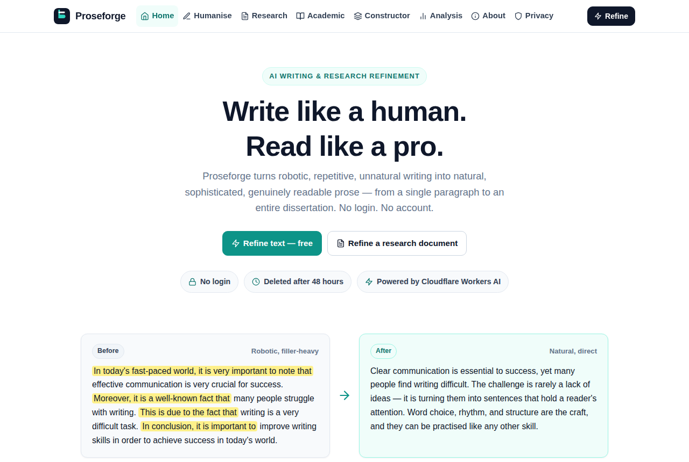
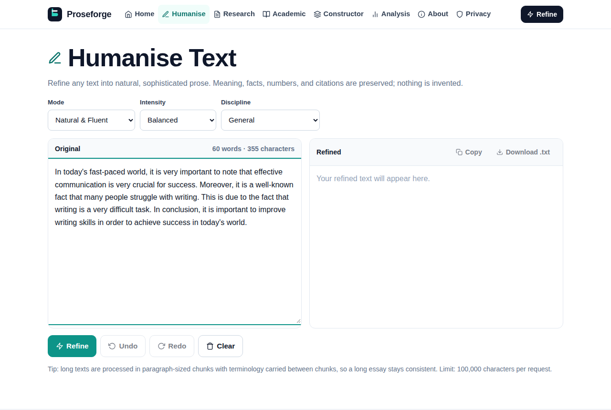
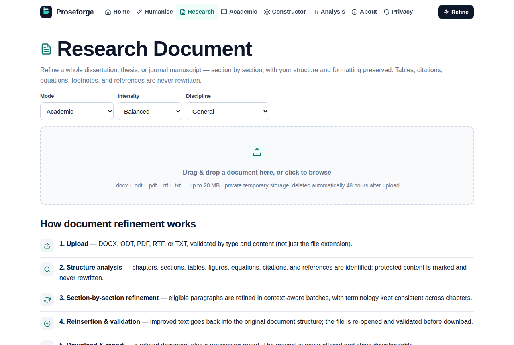
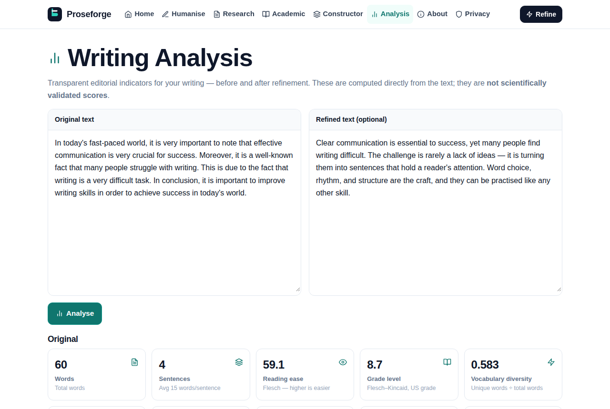
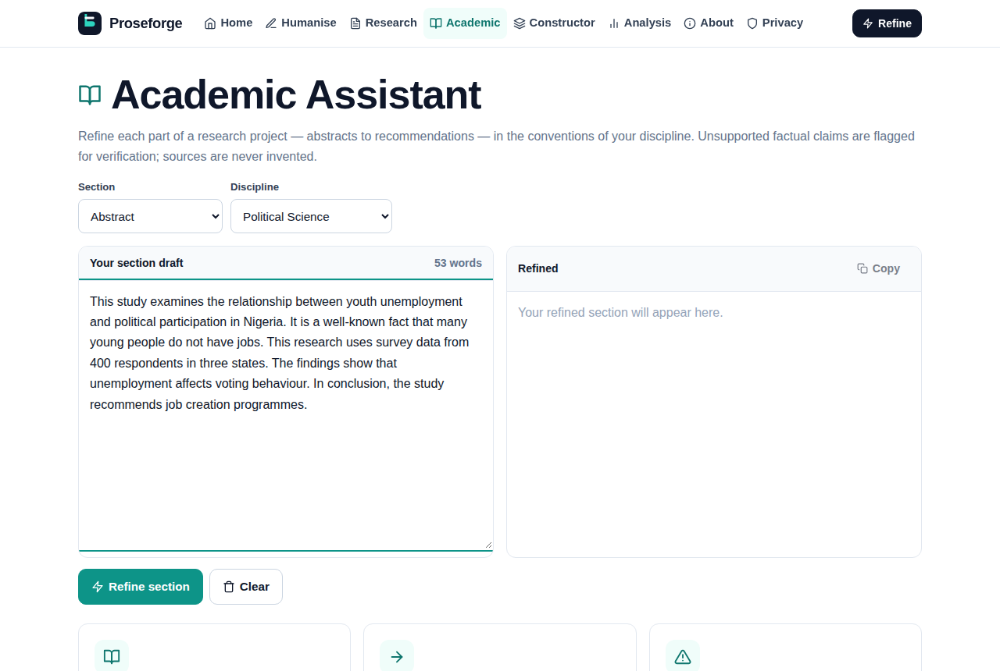

# Proseforge

**Write like a human. Read like a pro.**

Proseforge is an AI-powered human writing and research refinement platform. It turns robotic, repetitive, unnatural, and poorly constructed AI-assisted writing into natural, sophisticated, contextually appropriate, and genuinely readable prose — from a single paragraph to an entire academic dissertation.

No login. No account. Text is processed in memory and never stored; uploaded documents are deleted automatically after 48 hours.

> **What Proseforge will not do:** invent facts, statistics, quotations, or references; change research results, numbers, citations, or equations; or claim to make text undetectable by AI detectors. Detector-evasion is not a feature.

## Screenshots


*Homepage — hero, before/after example, and the try-it-now workspace.*


*Humanise Text workspace — modes, intensities, disciplines, side-by-side panels.*


*Research Document workspace — drag-and-drop upload, the six-step pipeline, protected content.*


*Writing Analysis — readability, vocabulary diversity, and tone, before and after.*


*Academic Assistant — refine each section of a research project in your discipline's conventions.*

## Features (Milestone 1 — shipped)

- **Humanise Text** — 10 refinement modes (Natural & Fluent, Academic, Advanced Academic, Professional, Conversational, Technical, Concise, Expanded, Formal, Custom Voice) × 3 intensities, across 16 academic disciplines, with side-by-side comparison, word/character counts, copy/download/clear, and undo/redo.
- **Academic Assistant** — abstract, introduction, problem statement, objectives, questions, hypotheses, methodology, results, discussion, conclusion, recommendations; unsupported factual claims are flagged for verification, never given invented citations.
- **Writing Constructor** — three alternative constructions of any sentence or idea, side by side.
- **Writing Analysis** — readability, vocabulary diversity, repetition, sentence variation, tone, and more, computed locally and honestly labelled as editorial indicators, not scientifically validated scores, with before/after comparison.
- **Research Document** — whole dissertations and theses: DOCX and ODT with structural preservation, RTF, TXT, and text-layer PDF (see `docs/03-roadmap.md` for the honest limits on PDF layout and scanned PDFs).
- **Privacy by design** — no accounts, no public document URLs, security headers/CSP, rate limiting, request-size limits, and a 48-hour server-side deletion mechanism (scheduled cleanup + storage lifecycle backstop).

## AI provider — Workers AI is the only required provider

Proseforge runs on **Cloudflare Workers AI — no extra key is needed**. Deploy with the `ai` binding (already declared in `wrangler.jsonc`) and refinement works. The default model is `@cf/meta/llama-3.1-8b-instruct-fp8`, changeable via the `AI_MODEL` variable.

An **optional** OpenAI-compatible adapter exists in `src/providers.ts` for operators who prefer a different provider. It is never required, no key is ever requested from users, and the app returns a clear setup message (HTTP 503) — never a faked refinement — when no provider is configured.

## Quick start

```bash
npm install
npm test          # 78 tests, must pass
npm run build     # typecheck + asset check
npx wrangler dev  # local dev at http://localhost:8787
npx wrangler deploy
```

Full deployment instructions: [`docs/DEPLOYMENT.md`](../docs/DEPLOYMENT.md). Architecture: [`docs/02-architecture.md`](../docs/02-architecture.md). Discovery/verification notes: [`docs/01-discovery.md`](../docs/01-discovery.md). Roadmap: [`docs/03-roadmap.md`](../docs/03-roadmap.md).

## Project layout

```
proseforge-platform/
  public/        # Frontend: index.html, styles.css, app.js (vanilla JS SPA, hash-routed)
  src/           # Worker: index.ts (API), modes.ts, prompts.ts, providers.ts,
                 #   analysis.ts, chunking.ts, security.ts, types.ts,
                 #   docx.ts, odt.ts, pdf.ts, rtf.ts, documents.ts, store.ts
  tests/         # Vitest suite (78 tests, incl. real DOCX/ODT fixtures)
  migrations/    # D1 schema for Milestone 2 job metadata (no document content, ever)
  scripts/       # build-check
  wrangler.jsonc # Workers config: ai binding, R2 + D1 + Queues (M2), hourly cleanup cron
```

## API

| Endpoint | Method | Notes |
|---|---|---|
| `/api/health` | GET | Service status + configured provider (no secrets) |
| `/api/config` | GET | Modes, intensities, disciplines, limits |
| `/api/refine` | POST | `{ text, mode, intensity, customVoice?, discipline? }` |
| `/api/academic` | POST | `{ text, section, discipline? }` — 11 sections |
| `/api/construct` | POST | `{ text, discipline? }` — 3 alternatives |
| `/api/analyse` | POST | `{ text, refinedText? }` — local, no AI call |
| `/api/documents/upload` | POST | Multipart upload → 202 + job id; processing runs in the background |
| `/api/documents/:id/status` | GET | Progress, stage, summary, fresh 15-minute download token when done |
| `/api/documents/:id/report` | GET | Full processing report (chapters, counts, limitations, warnings) |
| `/api/documents/:id/download?token=…` | GET | Refined document (`kind=refined`) or original (`kind=original`) |
| `/api/documents/:id/retry` | POST | Re-run a `needs-provider` or `failed` job |

## Contributing / Security / Privacy

See [CONTRIBUTING.md](CONTRIBUTING.md), [SECURITY.md](SECURITY.md), [PRIVACY.md](PRIVACY.md). License: MIT — see [LICENSE](LICENSE).
